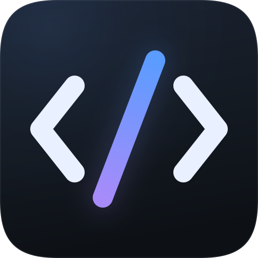
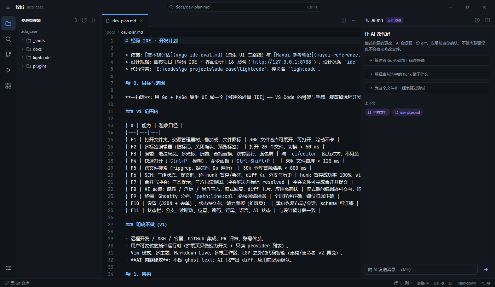

# ada_case

轻码 IDE（LightCode）：一个用 Go + [MyGo](https://mygo.run/zh/docs) 原生 UI 写的轻量代码编辑器。



```
lightcode/     编辑器：窗口、侧栏、编辑、Git、终端
docs/          设计与计划（dev-plan、mygo-ide-eval、mayoi-reference …）
build.bat      Windows 编译脚本，产物在 bin/
```

## 快速开始

```bat
build.bat --run         :: 发布构建到 bin\lightcode.exe 并启动
build.bat --debug       :: 保留控制台与符号的调试构建
build.bat --test        :: 构建前先跑 go vet 与 go test
```

也可以直接跑：

```powershell
cd lightcode
go run ./cmd/lightcode
```

编辑器需要本地 MyGo 检出（默认 `../mygo`；`lightcode/go.mod` 目前指向上游 v0.7.4，
而应用用到的个别 API 还只在本地框架里，`build.bat` 会创建 `lightcode/go.work` 指过去），
Go 1.27+，Windows 10 1809+ / macOS 13+ / Linux（GTK 3）。

## 文档

| 文档 | 内容 |
|---|---|
| [docs/dev-plan.md](docs/dev-plan.md) | 里程碑、验收口径、WBS、进度日志 |
| [docs/mygo-ide-eval.md](docs/mygo-ide-eval.md) | MyGo 做 IDE 的技术评估 |
| [docs/mayoi-reference.md](docs/mayoi-reference.md) | 参考实现的笔记 |
| [lightcode/README.md](lightcode/README.md) | 编辑器的功能、结构、约定与测试 |

## 测试

```powershell
cd lightcode ; go build ./... ; go vet ./... ; go test ./...
```


