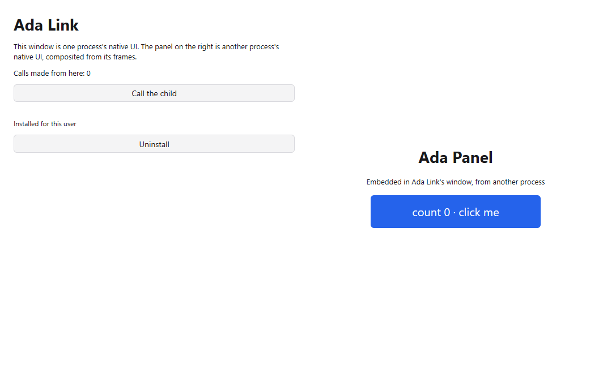
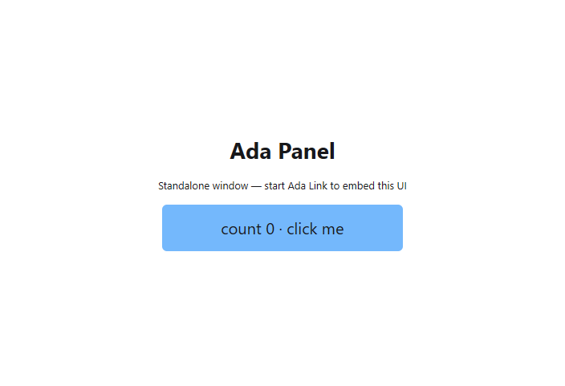
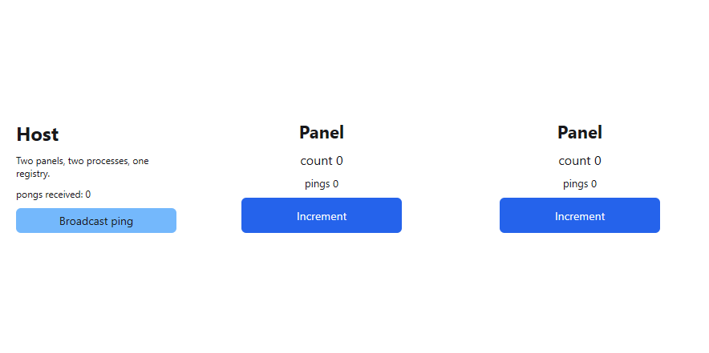
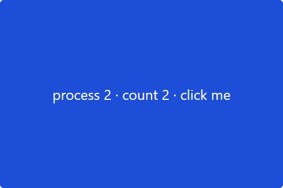

# ada_link

> **已并入 [ada_case](../lightcode/README.md) 仓库**（本目录 `ada_link/`）：源码随编辑器与 AI 插件一起构建，`bin/` 与 `artifacts/` 未随迁。为进程插件做了两处小改动——`link.Peer` 接受 `io.ReadWriteCloser`、新增 `link.PipeConn` 与 `link.NewQuietPeer`/`Start`；其余能力（socket 会话、帧环、多面板、安装器）保持原样。

**把另一个 MyGo 应用的 native UI，嵌进你的 MyGo 窗口——进程隔离，像素中继，类型化 IPC。**

MyGo（[github.com/egoist/mygo](https://github.com/egoist/mygo)）的 native UI（包 `ui`）是
每个进程自己的 GPU 场景，没有跨进程句柄。本项目把两个进程接起来：

- **子进程**用 `ui` 写自己的界面（与 `WindowOptions.Content` 完全相同的 `ui.View`），
  离屏渲染成帧；
- **宿主进程**把帧当作纹理合成进自己的 native UI，转发指针、键盘、文本、拖放；
- **两个进程之间**还有一条类型化的调用/事件通道（Unix socket + 长度前缀 JSON）；
- 帧走两个进程共享的**帧环**（premultiplied RGBA8888，3 槽，累计确认），不进 socket；
- 演示还带一个**按用户安装 / 卸载**的包装：安装后 Start Menu 出现 *Ada Link* 与 *Ada Panel*，
  Settings → Apps 里有卸载项，用来直观地看到"两个独立应用，一个嵌入另一个"。

它是一个 Go 库：`go get github.com/learningdog1/ada_link@latest`，其他 MyGo 项目可以直接
调用 `adalink.Spawn` / `Attach` / `Serve`，也可以只用 `link` 做进程间 IPC。详见
[`docs/library.md`](docs/library.md)。

```
宿主窗口                                   另一个进程
┌─────────────────────────────┐   socket   ┌──────────────────┐
│ Ada Link 的 native UI        │◀──────────▶│ Ada Panel 的 UI   │
│  ┌───────────────────────┐  │  帧环文件   │  （离屏渲染）     │
│  │ Ada Panel 的画面(纹理) │  │◀──────────▶│                  │
│  └───────────────────────┘  │            │  Panel 的 Go 服务 │
└─────────────────────────────┘            └──────────────────┘
```



## 安装 / 卸载（最直观的测试）

```powershell
.\bin\AdaLink.exe install          # 有确认弹窗；复制两个 exe、建快捷方式、写卸载项
.\bin\AdaLink.exe uninstall        # 有确认弹窗；删除上面的一切
.\bin\AdaLink.exe install --quiet  # 静默，不弹窗
.\bin\AdaLink.exe uninstall --yes --quiet
```

- 安装位置：`%LOCALAPPDATA%\Programs\AdaLink`（**按用户，无需管理员**）。
- 复制 `AdaLink.exe` 与 `AdaPanel.exe` 两个独立的 exe。
- Start Menu：**Ada Link**、**Ada Panel**；桌面：**Ada Link**。
- **Settings → Apps → Installed apps** 出现 `Ada Link 0.1.0`，卸载字符串指向
  `"…\AdaLink.exe" --uninstall`，因此从系统设置也能卸载。
- 卸载会移除快捷方式、注册表项与安装目录。从**已安装的那份**卸载时，程序退出后目录由一段
  延迟清理脚本删除（Windows 不能删除正在运行的 exe）。
- 应用窗口左侧也显示当前的安装状态：便携版显示 **Portable build / Install…**，已安装时显示
  **Installed for this user / Uninstall**。这两个按钮和命令行调用的是同一套代码。

```powershell
# 便携版直接跑（不安装）
.\bin\AdaLink.exe

# 同一个 Panel，单独启动时是普通窗口——这是"嵌入 vs 不嵌入"的直观对照
.\bin\AdaPanel.exe
```



## 作为库使用

```sh
go get github.com/learningdog1/ada_link@latest
```

```go
import adalink "github.com/learningdog1/ada_link"

sess, err := adalink.Spawn(adalink.SpawnOptions{
    Command: []string{childExe}, W: 720, H: 520, Scale: 2,
})
var panel *adalink.Host
mygo.App.WhenReady(func() {
    win := mygo.NewWindow(mygo.WindowOptions{
        BackgroundColor: "#ffffff", // live resize 时先填满新暴露的边缘
        Content: ui.View(func(c *ui.Context) { panel.View(c) }),
    })
    panel = adalink.Attach(win, sess)
})
mygo.App.Run()
```

子进程只需 `adalink.Serve(adalink.ServeOptions{View: app.view, Service: app.call})`。
多面板用 `panels.New()` 注册会话、挂窗口、按命名空间收事件并向所有面板广播（见
[`docs/panels.md`](docs/panels.md) 与 [`examples/multi`](examples/multi)）：



更细的 API 在 `.../link`、`.../mygoembed`、`.../panels`、`.../install` 四个包里；完整
说明、类型化调用、安装器与限制见 [`docs/library.md`](docs/library.md)，最小可运行例子见
[`examples/minimal`](examples/minimal)。

## 目录

| 路径 | 内容 |
|---|---|
| [`DESIGN.md`](DESIGN.md) | 设计文档：MyGo 现状分析、方案、取舍、分期、风险、验收 |
| [`docs/protocol.md`](docs/protocol.md) | 传输协议规范：握手、帧环布局、消息、输入、错误、安全 |
| [`docs/library.md`](docs/library.md) | 库使用指南：导入、宿主/子进程、调用/事件、安装、限制 |
| [`docs/panels.md`](docs/panels.md) | 多面板：Panel registry、事件命名空间与广播策略 |
| [`adalink.go`](adalink.go) | 库的便捷入口：`Spawn` / `Attach` / `Serve` 与常用类型 |
| [`link/`](link) | 传输、协议、帧环、输入、调用/事件的实现（不含 MyGo 类型） |
| [`mygoembed/`](mygoembed) | MyGo 接入：`Attach`（宿主视图）与 `Serve`（子进程） |
| [`panels/`](panels) | 多面板注册表、事件命名空间与宿主广播 |
| [`install/`](install) | 通用按用户安装/卸载（Windows）：文件、快捷方式、Settings 项、延迟清理 |
| [`internal/shm/`](internal/shm) | 文件支撑的共享映射（Unix mmap；Windows 页缓存 I/O） |
| [`examples/minimal/`](examples/minimal) | 最小宿主 + 子进程示例 |
| [`examples/multi/`](examples/multi) | 两个面板、一个 registry、命名空间事件与广播 |
| [`cmd/linkapp/`](cmd/linkapp) | Ada Link：宿主窗口 + 安装/卸载命令 |
| [`cmd/panel/`](cmd/panel) | Ada Panel：被嵌入的子进程；单独启动时显示普通窗口 |
| [`cmd/linkdemo/`](cmd/linkdemo) | 无窗口端到端演示：帧、点击、RPC，输出 PNG |
| [`bin/`](bin) | 编译好的 Windows x64 程序与测试说明 |
| [`artifacts/`](artifacts) | 演示生成的帧与窗口截图 |

## 跑起来

需要 Go 1.27+。`go.mod` 要求 `github.com/egoist/mygo v0.7.4`，并用 `replace` 指向同级的
MyGo checkout（`../mygo`）；删掉 `replace` 就会用发布版。**下游项目引用本库时，replace
不会继承**，需要自己指向同一个 MyGo（发布版或 `../mygo`），见
[`docs/library.md`](docs/library.md) 第 1 节。

```sh
# 单元测试与端到端（含子进程、帧、点击、RPC、resize）
go test ./...
go test -race ./...

# 编译出 bin/ 里的四个程序（Windows x64）
go build -trimpath -ldflags "-s -w -H=windowsgui" -o bin/AdaLink.exe      ./cmd/linkapp
go build -trimpath -ldflags "-s -w"               -o bin/AdaLink-console.exe ./cmd/linkapp
go build -trimpath -ldflags "-s -w -H=windowsgui" -o bin/AdaPanel.exe     ./cmd/panel
go build -trimpath -ldflags "-s -w"               -o bin/linkdemo.exe      ./cmd/linkdemo

# 无窗口演示：宿主派生子进程，保存三帧到 artifacts/
go run ./cmd/linkdemo

# 宿主窗口（需要桌面会话）；-shot 在第一帧出现后截图并退出
go run ./cmd/linkapp
go run ./cmd/linkapp -shot artifacts/window.png
```

`bin/` 里的程序：

| 文件 | 用途 |
|---|---|
| `AdaLink.exe` | GUI 宿主；双击运行，或 `install` / `uninstall` |
| `AdaLink-console.exe` | 同上，保留控制台日志（`-auto-close 5s`、`-shot`） |
| `AdaPanel.exe` | 子进程；由 Ada Link 以环境变量启动，或单独启动成普通窗口 |
| `linkdemo.exe` | 无窗口自检，打印帧/点击/RPC 的耗时并写 PNG |

`cmd/linkdemo` 的输出：

```
frame 1: 480x320
state: {N:0}
click: count 1 after 15ms
call: count 2 after 12ms
stats: 3 frames, 0 dropped, surface {W:480 H:320 Scale:1 Title:linkdemo child}
session ended: link: session closed
```



## 怎么用

宿主（窗口必须显示 native UI）：

```go
import adalink "github.com/learningdog1/ada_link"

sess, err := adalink.Spawn(adalink.SpawnOptions{
    Command: childCommand(),            // AdaPanel.exe，或自己 + -child
    W: 720, H: 520, Scale: 2,          // 初始 DIP 尺寸与 DPI 缩放
    Stderr: os.Stderr,
})
if err != nil { log.Fatal(err) }
defer sess.Close()

var panel *adalink.Host
win := mygo.NewWindow(mygo.WindowOptions{
    Title: "Ada Link", Width: 1080, Height: 700,
    Content: ui.View(func(c *ui.Context) {
        ui.Row(c).Fill().Children(func() {
            sidebar(c)                    // 宿主自己的控件
            panel.View(c)                 // 另一个进程的画面
        })
    }),
})
panel = adalink.Attach(win, sess)   // 帧、焦点、拖放、关闭

// 调用子进程的服务：
ctx, cancel := context.WithTimeout(context.Background(), 5*time.Second)
defer cancel()
raw, err := sess.Call(ctx, "Panel.Increment")
```

子进程（`cmd/panel`）：

```go
app := &panel{}
if os.Getenv(link.EnvSocket) != "" {
    err = adalink.Serve(adalink.ServeOptions{
        View:    app.view,     // 与 WindowOptions.Content 相同的 ui.View
        Service: app.call,     // 宿主调用；在 UI goroutine 上执行
        Title:   "Ada Panel",
    })
}
```

`adalink.Spawn`（即 `link.Spawn`）设置子进程的环境（socket、token、目录、尺寸），所以子
进程侧通常只需要 `Serve`；没有这些环境变量时，同一个 `AdaPanel.exe` 走普通窗口路径。

## 它证明了什么

- 两个进程的 native UI 可以合成在同一个窗口里，宿主的控件、z-order、DPI 与子进程互不干扰。
- 输入（点击、滚轮、键、文本、IME 组合、焦点、拖放）可转发，坐标无需换算。
- 服务调用与事件双向可用，语义沿用 MyGo 页面 IPC 的 `call`/`reply`/`event`。
- 帧环的背压与丢帧：3 槽 + 累计确认；宿主忙时合并帧，子进程不阻塞输入。
- 会话生命周期：启动、resize（换环）、关闭、子进程退出、临时目录清理。
- 安装层：按用户安装两个独立应用、Start Menu 快捷方式、Settings 卸载项、在运行中自删除；
  卸载后文件、快捷方式与注册表项都不残留。
- `-race` 通过；Windows 实机跑通了真实窗口、安装/卸载与截图。

## 它还没有证明（P2 之前）

v1 的子进程用 `ui.NewTester` 离屏渲染，**它是测试取向的 API**：

- CPU 光栅化 + `Image()` 的 BGRA→RGBA 转换约 3.2 ms/帧（1280×800），4K 不划算；
- 没有公共的无障碍树、光标形状、真实 IME 候选窗；
- `ui.Tester` 每个视图最多 settle 20 帧，同一父节点下重复的 `Key` 会 panic；
- 中键、双击计数等细节在 `Tester` 里不可表达（协议已支持）。

`DESIGN.md` 的 P2 给出上游改造：公共 `ui.Surface`（BGRA + damage + `SendInput` + 可访问树）、
`Window.CaptureFrame`（GPU 渲染器给原始帧 + damage）、`Window.SendInput`、
以及把 `mygo.Bind`/`NewEvent`/`Channel` 泛化到任意 `ipc.Peer`。P3 用显示列表中继替代像素
中继，分辨率无关、带宽极小。

安装层本身是可复用的库（`install` 包），但严格说它是演示包装：正式的 MyGo 应用应当用
[`mygo build` 的安装包与签名](https://github.com/egoist/mygo/blob/main/docs/distribution.md)。
`install` 覆盖的是"按用户、无管理员、装得上卸得干净"；用法见
[`docs/library.md`](docs/library.md) 第 8 节。

## 实测（Windows，i5-10500，Go 1.27.1）

| 项目 | 结果 |
|---|---|
| 整帧路径（build+render+RGBA 转换+damage，1280×800） | 3.5–3.8 ms |
| 帧环写入 / 读出（1280×800，4.1 MiB） | 约 0.94 ms（4.36 GB/s）/ 0.81 ms（5.03 GB/s） |
| 未变化帧检测 | 2.5 µs（空闲不建帧） |
| 点击 → 状态确认 + 新帧 | 14–16 ms（含一次 RPC） |
| 额外内存（1280×800） | 约 33 MiB |

数字的解读与限制见 [`DESIGN.md`](DESIGN.md) 第 5.3 节。

## 协议速览

```
host                                      child
  listen(session dir/l.sock, 0600)          dial
  spawn(env: SOCK, TOKEN, DIR, W, H, …)     create frames-1.bin
  read hello(token) ───────────────────────▶│ hello
  open frames-1.bin, validate header        │
  welcome ─────────────────────────────────▶│ welcome
  ◀──────────────────────── frame(seq,slot) │
  frame-ack(seq) ──────────────────────────▶│
  input ───────────────────────────────────▶│
  call/reply/event ⇄                        │
```

完整消息表、帧环头、输入字段、错误与安全规则见 [`docs/protocol.md`](docs/protocol.md)。

## 许可

MIT。
