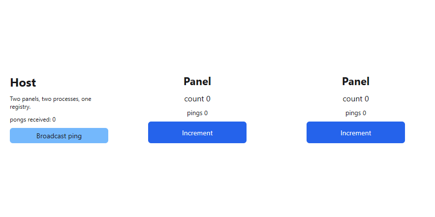

# 多面板：Panel registry 与事件命名空间



`panels` 包管理宿主进程里的多个嵌入面板：会话、状态、窗口、命名空间化的事件，
以及宿主向子进程的广播。它补上了 v1 里缺的两件事，而不引入跨进程的新协议。

导入：

```go
import "github.com/learningdog1/ada_link/panels"
```

## 1. 注册表

```go
reg := panels.New()

for _, p := range specs {
    sess, err := adalink.Spawn(adalink.SpawnOptions{
        Command: []string{panelExe},
        W: 520, H: 320, Scale: 1,
    })
    if err != nil { log.Fatal(err) }
    if _, err := reg.Add(p.ID, p.Title, sess); err != nil {
        sess.Close()
        log.Fatal(err)
    }
}

// 面板的画面放进窗口的元素里：
win := mygo.NewWindow(mygo.WindowOptions{Content: ui.View(func(c *ui.Context) {
    ui.Row(c).Fill().Children(func() {
        for _, snap := range reg.List() {
            if snap.Host != nil { snap.Host.View(c) }
        }
    })
})})
for _, snap := range reg.List() {
    if _, err := reg.Attach(snap.ID, win); err != nil { log.Fatal(err) }
}
```

- `Add(id, title, sess)`：ID 必须唯一、不含 `/` 与空白（它要进 topic）；title 为空时用子进程标题。
- `Attach(id, win)`：把该面板的帧接进窗口（`mygoembed.Attach`），一个面板一个视图。
  多个面板可以挂在同一个窗口的不同元素上。
- `Get` / `List` / `IDs`：快照，按添加顺序；`State` 为 `Running`、`Closed`、`Failed`。
- `Remove(id)`：从注册表移除并关闭会话；`Close()`：全部移除并关闭。
- `OnChange(fn)`：`Added` / `Updated` / `Removed`，面板结束时 `Updated` 带 `Failed` 与 `Err`。
  回调在改变发生的地方执行（包括会话读协程），**不能阻塞**。

状态来源：`Session.Done` 后，若 `Err()` 是 `link.ErrClosed`（宿主主动关闭/正常 bye）为
`Closed`，否则为 `Failed`。失败的面板留在注册表里，方便 UI 显示错误并重试；重试用新的
会话、新的 ID 或先 `Remove` 再 `Add`。

## 2. 事件命名空间

子进程 → 宿主：

| 层面 | 形状 | 例 |
|---|---|---|
| 子进程发出 | `Emit("ready", payload)` | `{"n":1}` |
| 宿主收到 | `panel/<id>/<name>` | `panel/orders/ready` |

```go
off := reg.OnEvent("ready", func(e panels.Event) {
    // e.Panel: "orders"; e.Name: "ready"; e.Topic: "panel/orders/ready"
    var s state
    json.Unmarshal(e.Payload, &s)
})
```

- `OnEvent(name, fn)`：所有面板（含之后 `Add` 的）的同名事件，宿主自己命名空间化。
- `OnPanelEvent(ids, name, fn)`：只订阅指定面板，不跟随后来添加的面板。
- `Topic(id, name)` / `SplitTopic(topic)`：构造与解析 `panel/<id>/<name>`。
- `HostTopic(name)`：保留的宿主侧命名空间 `host/<name>`，给未来的 Hub 与 UI 用。

宿主 → 子进程：

```go
res := reg.Broadcast("theme", Theme{Dark: true}, panels.BroadcastOptions{
    Exclude: []string{"settings"}, // 发起变化的面板不必收到
})
if err := res.Err(); err != nil { log.Print(err) }
```

- 广播发送的 **name 不加命名空间**：子进程收到它认识的 `"theme"`，而不是 `panel/...`。
- 默认只发 `Running` 面板；`Closed: true` 才包含已结束的（通常 `Emit` 会失败）。
- `Include` / `Exclude` 选择面板；`BroadcastTo(ids, ...)` 是只发给这些面板的简写。
- 发送**并发**进行，一个慢子进程不会拖住其他面板；`BroadcastResult.Sent` 是成功者，
  `Errs` 按面板记录失败，`OnError` 在全部返回后逐个回调。
- 广播不是原子屏障：各面板在自己的进程里渲染，时机不同。需要视觉一致性时，事件里带
  版本/epoch，由子进程决定何时应用，而不是假设同时到达。

顺序与投递：

- 单个会话内的事件顺序保持（`link.Peer` 的读循环顺序）。
- 跨会话没有全局顺序；不要把"面板 A 先收到、B 后收到"当作因果。
- 事件在第一个监听者出现前由 `link.Peer` 保留（每个名字最多 64 条），所以 `Emit` 在
  注册监听之前发生不会丢。
- 监听器在会话读协程上执行，**不得阻塞**；耗时工作在回调里起 goroutine，或用 Hub 的队列。

## 3. 什么时候还需要 Event Hub

Registry 解决的是"有哪些面板、事件属于谁、广播给谁"；它故意不解决：

- 一个事件给多个宿主组件/页面（N×M 扇出）；
- 每个订阅者的有界队列、丢弃/合并策略；
- 最新值缓存（新面板/新页面要"当前状态"而不是从头追事件）；
- 宿主页面（webview）也订阅子进程事件；
- 跨面板聚合、日志、指标。

出现其中两项以上，再在 Registry 之上加一个**进程内 Hub**（建议包 `eventhub`）：

```
会话读协程 → 非阻塞入队 → Hub dispatcher → 每个订阅者的有界队列 / latest 缓存
                                      → 宿主 MyGo Event / 其他子进程 sess.Emit
```

Hub 不改变 `link.Proto`，也不改变本包的 API；它消费 `registry.OnEvent` 与
`registry.Broadcast` 的结果即可。反过来说，只有 2-3 个面板、事件各喂各的 UI 时，
直接用 `reg.OnEvent` 更简单，也少一层故障点。

## 4. 边界与信任

- 子进程事件是**数据**，不是命令：不要用事件名直接触发宿主的特权动作（文件、网络、
  权限）。要命令，走 `Session.Call` 的服务（有明确的 handler 与校验）。
- topic 只做分发；宿主页面订阅时仍受 MyGo 页面信任模型约束。
- 广播的 `name` 由宿主给出，子进程要能处理未知事件：忽略未知名字是向前兼容的一部分。

## 5. 与帧的关系

Registry 只碰小事件与生命周期；帧仍然走共享帧环，`Host` 在主线程"只留最新"。
不要把帧放进事件系统：4 MiB 的帧经 JSON 会把帧率、内存与背压全部拖垮。
