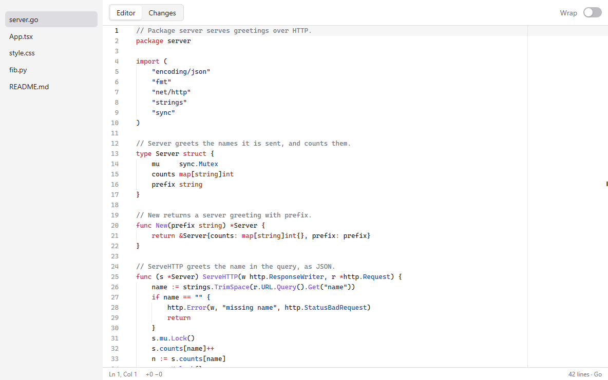
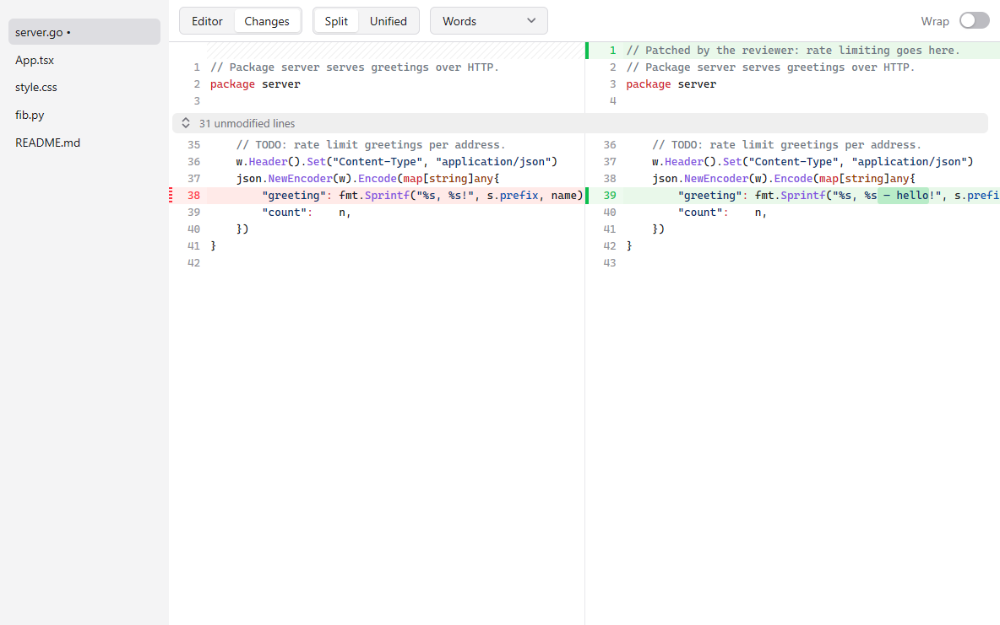

# 轻码 IDE · Go + MyGo 技术栈评估（修订版）

> **修订说明（2026-11-17）**：上一版把主路线定为「webview 前端 + Monaco」。看过官方 `examples/code-editor`（本地 `E:\codes\go_projects\mygo\examples\code-editor`）并实跑后修正：**MyGo 自带一个 Zed 风格的原生代码编辑器与 diff 查看器**，主路线改为「原生 UI + 内置 editor」，webview 降级为预览与插件 UI 的补充。下文标 ★ 的是因这次实测而改变的部分。

## 0. 结论

1. ★ **原生编辑器可用，而且和设计稿的需求对得很准**：绳索缓冲、百万行文件、多光标、折叠、查找替换、补全/悬停/诊断/内联提示、Git 改动标记、以及 **Revert / Keep 的逐 hunk 审查** —— 正好是「源代码管理」「冲突解决」「AI 改动确认」三张稿要的东西。
2. ★ **主路线：纯原生 UI（Go + `ui` 包），编辑器用 `ui/editor`**。本地实测：首个窗口 272 ms、常驻 55.8 MB（工作集）、单文件 17 MB（未 strip；文档的发布构建约 9.7 MB）。带 webview 的窗口拿不到这个数字。
3. ★ **代价从「选编辑器」变成「做外壳」**：活动栏、标签条、侧栏树、面包屑、状态栏、命令面板、设置表单、AI 面板三态与浮标、diff 卡片，全都要用 `ui` 包自绘。参照 `Mayoi`（同框架的真实 IDE，非测试约 10.6 万行），我们这 16 张稿的 MVP 约 **2–2.5 万行、12–18 人周**（见 [mayoi-reference.md](mayoi-reference.md)）。
4. ★ **风险清单换血**：原「编辑器性能 / webview 内存」降级；新首要是 **外壳工作量与设计保真**、**LSP 与树解析（无 cgo）**、**跨文件搜索**、以及 0.9.x 的 API 变动。
5. 原 webview 评估不删，作为退路附录（第 9 节）。

## 1. ★ 官方示例实测（2026-11-17）

环境：Windows 11，Go 1.27.1，仓库 commit `5b33c40`（2026-11-03），`go build ./examples/code-editor`。

| 指标 | 实测值 | 备注 |
|---|---|---|
| 二进制 | 17.1 MB | `go build` 未 strip；文档发布构建约 9.7 MB |
| 首个窗口 | 272 ms | 进程启动 → `MainWindowHandle` 出现 |
| 工作集 / 私有内存 | 55.8 MB / 67.7 MB | 1200×800 窗口、5 个示例文件、空转 3 s 后 |
| 线程 | 28 | 含 Direct3D 11 渲染线程 |
| 窗口内容 | 1184×741 | `CapturePage` 输出，即客户区 |

示例覆盖了什么（文档 + 代码核对）：

- **Buffer**：持久化块树（类似 Zed 的 rope），版本共享，`Snapshot` 可跨 goroutine 读；CRLF 保留在 `WriteTo`；undo 按事务合并。
- **编辑**：多光标（`Cmd+D` / `Cmd+Shift+L` / `Alt+Click` / 列选）、结构化扩选、按行移动/复制/删除/合并、注释、缩进、自动闭合括号、Enter 智能缩进、折叠（含 import 段）、查找替换（大小写/全词/正则/选区）、跳转到行、`Cmd+Click` 定义。
- **语言**：33 种内置分词器（Go/TS/JS/JSON/Python/Rust/C/C++/Java/Kotlin/Scala/Swift/Dart/C#/Shell/YAML/TOML/SQL/R/Ruby/Lua/PHP/CSS/HTML/XML/Markdown/diff/Dockerfile/Makefile/Protobuf/GraphQL/Zig）；`Highlighter` 接口可插 tree-sitter 之类的解析器（增量 `Edit` + 预算 `Highlight`）；`SyntaxSelector/Folder/BracketMatcher/Indenter` 可选实现。
- **智能**：`OnCompletion` / `OnHover` / `OnDefinition` / `SetDiagnostics`（版本号随编辑迁移）/ `SetInlays` / `SetSuggestion`（我们不用 —— 与「不要内联建议」的规则冲突）。
- **Git 相关**：`DiffBase` 在行号槽画增删改条、`Cmd+F8` 跳到下一处改动、`Cmd+Alt+Z` 还原该处；`ParsePatch` 解析 `git diff`（重命名/模式/新增删除），`FilePatch.Apply` 应用。
- **Diff 视图**：并排/统一、词/字符级内联高亮、上下文折叠（默认 3 行，点击展开 100）、可编辑新侧、`HunkActions` 的 Revert/Keep、行选择（用于评论）、行下注释位、`SetPatch` 显示 PR 的补丁、`SplitPercent` 可持久化、`LineTop`/`ScrollY` 足以自绘 minimap。比较算法是 git 的 histogram + Myers 兜底 + indent heuristic。
- **无障碍**：编辑器对辅助技术是一个带名字的多行文本框，补全列表、查找栏都有语义；输入法候选窗跟随光标。

示例**没有**覆盖（= 我们要自己做的）：

| 缺口 | 说明 |
|---|---|
| 文件 I/O | 文件是硬编码的 `samples.go`，没有打开文件夹、保存、编码探测、外部改动冲突 |
| 标签页 / 编辑组 | 只有一个编辑器 + 一个文件列表；没有标签条、未保存圆点、关闭确认、预览标签 |
| Git 面板 | `DiffBase` 只做「工作区 vs 原文」，没有 status/暂存/提交/分支/历史 |
| 命令面板 | `ui` 无内置 palette；只有编辑器内部的补全模糊匹配（`fuzzyScore` 未导出） |
| 设置 / 扩展 | 有表单控件，但没有 schema、迁移、能力开关 |
| 跨文件搜索 | 编辑器只有单文件查找 |
| 终端 | 在另一个示例里（`plugins/terminal`，仅原生 UI） |
| AI 面板 | 无；但 `ui/markdown` 的流式渲染（50 KB 回复 0.8 ms/帧）够用 |
| LSP | 只有回调接口，没有进程管理/JSON-RPC 桥 |

## 2. ★ 能力基线（原生 UI 视角）

| 能力 | 事实 | 对 IDE 的含义 |
|---|---|---|
| 编辑器 | `ui/editor`：rope、百万行、多光标、折叠、查找替换、补全/悬停/诊断/内联、Git 改动、可插高亮器 | 直接可用；不用 Monaco |
| Diff | `editor.DiffView`：并排/统一、词级内联、折叠、可编辑、hunk Revert/Keep、注释位、patch 解析/应用 | 三张 Git 稿的底座 |
| 外壳控件 | `ui` 有 Tabs/TabsBase、Tree、Outline（虚拟化、带列）、Sidebar、Split、Toolbar、List/Table、Combobox、Popover/Menu、Toast、Tooltip、Form、Segmented、Switch | 外壳靠拼装，不靠现成 IDE 模板 |
| 富内容 | `ui/markdown`（流式）、`rich-text`、`chart`、`video`、`pdf`、`web-view` | AI 回复、README 预览、PDF 预览 |
| 窗口 | `TitleBarHidden` + `c.TitleBar()` + `DragWindow`；`HideWindowButtons` 可自绘按钮；`Frameless`；`CapturePage` | 40 px 自定义标题栏可行 |
| 主题 | `ui.Theme`（背景/表面/文字/边框/强调…）+ 元素级 Border/Radius/Shadow/Gradient/Blur/Cache | 设计 token 可映射，但色值与字体要自己定 |
| 终端 | `plugins/terminal`（Ghostty libghostty-vt），**仅原生 UI**；macOS 13+/glibc 2.28/Win10 1809+；lib 按平台随包分发 | 原生路线反而白得一个强终端；代价是最低系统版本 |
| 文件监视 | `mygo.WatchFiles`（递归/忽略/debounce 50–500 ms/HintsOnly），条目上限 **macOS 65536、其他 8192** | 大仓库仍要 `HintsOnly` 或自建 |
| 密钥 | `mygo.Secrets`，单条 ≤ 2560 字节，系统凭据库 | AI Key 够用 |
| 测试 | `ui.NewTester` 无头跑视图；`CapturePage` 出图；`automation` 插件 + `mygo-automation` CLI 控窗口/输入/截图 | 截图回归可脱离浏览器 |
| IPC | ★ 原生路线**没有 IPC**：视图直接调 Go，`Window.Update` 回写；页面（webview 面板）才有 Bind/Channel | 少一层序列化，但要注意主线程与 `Update` 规则 |

## 3. ★ 四个结构性决策

### D1 窗口形态：原生 UI 为主

| 方案 | 判断 |
|---|---|
| **原生 UI（Go + `ui`）** | ★ **推荐**。启动/内存最优；编辑器与终端都是一等公民；无 webview 依赖，安装包不挑 WebView2/WebKitGTK；代价是全部外壳自绘、设计保真靠手工 |
| 纯 webview + Monaco | 退路。设计稿可 1:1 落地、生态现成；但编辑器、终端（xterm.js）、内存、启动全面让位，且 IPC 与流式要设计 |
| 混合（原生窗口内嵌 `ui.WebView`） | 局部用：HTML/PDF/插件预览。整窗混合会带来缩放、滚动、焦点、截图（`CapturePage` 有洞）的额外成本 |

**建议**：整窗原生 UI；`ui.WebView` 只用于「不可信的第三方 HTML」与「需要 Web 渲染的预览」（插件 UI 一律 `Untrusted`）。

### D2 编辑器内核：内置 `ui/editor`（Monaco 仅在 webview 退路里）

- 内置编辑器已覆盖设计稿里编辑区的全部交互（多光标、折叠、查找替换、补全、悬停、诊断、Git 改动）。
- Monaco 的优势（diff editor、monaco-languageclient、a11y、TS 生态）在原生路线里被 `editor` + `DiffView` + LSP 回调替代。
- **唯一要实测的**：10 MB / 100 万行文件的实际手感、超大单行的横向滚动、tree-sitter 类高亮能否无 cgo 落地。
- 参照 `Mayoi`：它**没有**用 `ui/editor`，而是用 `TextAreaBufferBase` + 自绘装饰 + `chroma`（因为要共享 undo、Vim、装饰、Markdown Live）。我们不需要这些，先用 `editor`；但要把「Document / Editor / Column 三层」照搬（见 mayoi-reference 2.2），否则分屏撤销会分裂。
- 若将来必须 Web 生态（扩展市场、LSP 客户端库），再走附录的 webview 路线；编辑器契约（Buffer/State/DiffState）不变，只换绘制层。

### D3 扩展模型（不变）

MyGo 插件是**构建期**的 Go 包 + npm 包，不是用户可安装的运行时扩展。v1 把「扩展」页做成**能力面板**（Git / AI / 终端 / 预览器 / 格式化的开关 + 只读 provider 列表）；v2 若要第三方，做 WASM（`wazero`，纯 Go）宿主或 untrusted webview 面板。这条要和产品先对齐。

### D4 终端：原生 Ghostty（不再是 xterm.js）

- 原生路线下 `plugins/terminal` 直接可用：真终端（reflow、Kitty 键盘协议、图片粘贴、OSC 133、搜索、主题），把 `terminal.View` 放进底部分栏即可。
- 代价：最低系统版本被抬到 **macOS 13 / glibc 2.28 / Win10 1809**；libghostty-vt 需随包分发、签名；Windows 走 ConPTY。
- 与编辑器的键位冲突要专门处理（终端优先拿 `Ctrl+C`、`Shift+Insert` 等，见第 4 节第 12 条）。

### D5 外部依赖：Git CLI、ripgrep、gopls

| 依赖 | 方案 | 理由 |
|---|---|---|
| Git | 系统 `git` CLI + `editor.ParsePatch` / `FilePatch.Apply` | 兼容性最好；diff/补丁的解析与展示已有内置实现 |
| 跨文件搜索 | 打包 ripgrep（三平台）+ 无则 Go 遍历 | 编辑器只有单文件查找；rg 的 ignore 语义与速度是刚需 |
| LSP | 外部进程（gopls / typescript-language-server）+ 回调桥接 | `editor` 只提供 `OnCompletion/OnHover/OnDefinition/SetDiagnostics`，不内置语言服务 |

## 4. 评估域（18 条，★ 为本次改写）

口径：Windows 11 / 16 GB 为基线，另测 macOS/Linux；仓库样本 `small` 2k / `mid` 30k / `big` 200k 文件；冷启动 5 次取中位数。

### ★ 4.1 启动、内存与包体
- 问：空壳（标题栏 + 标签 + 树 + 编辑器 + 状态栏）冷启动到可编辑多久？打开 mid 仓库后内存？三平台差异？
- 验：照示例的测法（首窗时间 + 工作集 + 私有内存）；再叠一个真实仓库。
- 线：冷启 < 400 ms；空壳 < 90 MB；mid 仓库 < 250 MB；安装包 < 25 MB。
- 注：示例 272 ms / 55.8 MB 是「编辑器 demo」，外壳与索引会加码。

### ★ 4.2 编辑器：大文件与百万行
- 问：1 / 10 / 100 MB、100 万行文件的打开、滚动、编辑、撤销；超长单行（压缩 JSON）的横向滚动；折叠 + 语义高亮的帧时间；`DiffBase` 在 10 万行文件上的开销。
- 验：用真实日志/压缩 JSON/生成的大 Go 文件；记录打开到可编辑、滚动 p99 帧、内存曲线。
- 线：10 MB < 1 s 可编辑；100 万行滚动不掉帧；100 MB 允许降级（关高亮/关折叠）。
- 风险：中（编辑器自称百万行，但要自己复现）。

### 4.3 中文输入、字体与排版
- 问：IME 组合与候选窗是否贴光标；`NoInputMethod` 只在特殊模式用；JetBrains Mono / 思源黑体的注册与回退；CJK 双宽、行高、`c.SetZoom` 放大后的列宽；`--text-scale` 等价（`ui` 主题字号）。
- 验：中文/日文输入法各一轮；缩放 100/125/150%；截图比对。
- 线：0 丢字、候选窗不漂移、列宽正确。
- 风险：低（原生文本输入比 webview 更稳）。

### ★ 4.4 设计保真与主题
- 问：把 16 张稿的 token（深色 `#0f1216`、面板 `#14181e`、强调 `#5b9cff`、AI `#a78bfa`、4/6/8/12 圆角、1 px 边框、48/240/380 宽度）落成 `ui.Theme` + 元素样式后，观感能到几成？字体（Inter / JetBrains Mono）需 embed 注册；行高 20 px vs 默认 1.5 倍。
- 验：先做「主窗（深色）」一张的 1:1 复刻，和设计稿并排比对（`CapturePage` 出图）。
- 线：主窗复刻 ≥ 90% 视觉一致；状态色/间距不出戏。
- 风险：**高**（原生绘制没有 CSS，圆角/阴影/描边要逐个调）。

### ★ 4.5 外壳组件工作量
- 问：活动栏（5 图标 + 徽标）、标签条（未保存点、关闭、溢出、拖拽排序）、侧栏（分组 + 计数 + 树/大纲）、面包屑、状态栏（分段 + 图标 + 悬停）、命令面板（浮层 + 模糊匹配 + 分类 + 最近使用）、设置表单、扩展开关列表、AI 面板三态 + 浮标 + 预览卡、diff 卡片、toast、右键菜单。
- 验：按稿逐件做，记录每件实际耗时（这是排期的主要输入）。
- 线：单件不超过 3 人日；整体 12–18 人周（Mayoi 同框架 10.6 万行，是我们的 3–4 倍功能集）。
- 校准：命令/键位/窗口 3 周、侧栏树 2–3 周、SCM+diff+历史 4 周、冲突/合并 2 周、AI 面板 2 周、终端+设置 2 周、打磨回归 2 周。
- 风险：**高**（这是「原生路线」真正的成本中心）。

### ★ 4.6 同进程调用与线程规则
- 问：视图直接调服务时，慢操作放 goroutine + `Window.Update` 回写；`Buffer` 快照跨线程安全；AI 流式回调如何切片上屏（每帧预算）；避免在视图里做 I/O。
- 验：用「打开 30k 文件仓库 + AI 流式 + 搜索」并发压测，观察帧时间。
- 线：视图帧 < 2 ms；无数据竞争（`-race`）。
- 风险：低（但纪律要立）。

### 4.7 文件读写与编码
- 问：GBK/Big5 探测、BOM、CRLF 保留（`Buffer.LineEnding` 已处理）、符号链接、Windows 长路径/UNC、只读文件、原子保存、外部改动冲突（编辑器 buffer 版本 vs 磁盘 mtime/hash）。
- 验：20 个编码样本 + 网络盘 + 双编辑器同时改。
- 线：编码往返无损；冲突提示「覆盖/另存/合并」。
- 风险：中。

### 4.8 文件监视
- 问：`WatchFiles` 8192 条目上限（mid 仓库很可能触顶）；`HintsOnly` 是否够用于 SCM 徽标与树刷新；`.gitignore` 过滤要自己做；编辑器自身保存的回环；Windows `ReadDirectoryChangesW` 丢事件。
- 验：mid/big 仓库 10 分钟 + 200 次改动，统计漏报/重复/延迟。
- 线：改动 → 徽标更新 < 500 ms；无回环；允许合并但不允许漏。
- 风险：**高**（可能需要自建 per-dir watcher 或 `HintsOnly` + 定期全量）。

### ★ 4.9 跨文件搜索与索引
- 问：rg 打包（三平台、签名、体积、许可）；无 rg 时 Go 遍历的性能；结果流式与取消；ignore 规则；符号索引（为 AI 上下文与「转到符号」）。
- 验：20 条查询在 mid/big 上跑，记录首条/全部结果时间。
- 线：mid 首条 < 800 ms；big < 3 s；可取消。
- 风险：中。

### ★ 4.10 LSP 桥
- 问：gopls/TS 服务进程拉起、JSON-RPC 与 `editor` 回调的映射（补全/悬停/定义/诊断/内联提示）；诊断版本号与编辑迁移；首次诊断时延；大仓库内存；崩溃重启；多根工作区。
- 验：Go 单测仓库 + 10 万行仓库；kill 服务看恢复。
- 线：mid 首次诊断 < 10 s；崩溃 3 s 内恢复；格式化/重命名可用。
- 风险：中高（回调接口是现成的，难在进程与协议）。

### ★ 4.11 Git
- 问：`git status --porcelain=v2` 的解析与节流；hunk 级暂存（**照 Mayoi 的算法**：读索引文本 `git show :path` → 与缓冲区做行级 diff → 只取重叠 hunk 合并 → `git hash-object` 写 blob + `git update-index`，不拼 patch、不做 fuzz）；`DiffView` 的 Revert/Keep 与暂存/丢弃的语义映射；冲突读取（`ls-files -u`）与三方视图（`DiffState` 只有两方，需要「base/ours/theirs」三缓冲组合）；rebase/merge/fork 中间态；credential helper 弹窗（`GIT_TERMINAL_PROMPT=0` + SSH `BatchMode`）；LFS/submodule。
- 刷新策略照抄：树变化 / 保存 / Git 命令后 / 窗口聚焦 / 每 5 s 轮询，相同 status 丢弃；每 1.5 s 检查 `index`、`HEAD`、`FETCH_HEAD` 的 mtime（终端里提交也能发现）。
- 验：mid/big 仓库全链路；CRLF/二进制/大文件样本。
- 线：status < 1 s（mid）；hunk 暂存成功率 100%；冲突视图能读三方。
- 风险：中高（三方合并视图是唯一「库里没有」的部件）。

### ★ 4.12 终端
- 问：`terminal.View` 嵌底部分栏；lib 随包分发与签名；Windows ConPTY；全屏程序（vim/htop）；高吞吐；滚动缓冲；链接点击（`OpenLink` 能把 `path:line:col` 交给编辑器打开 —— 白得的能力）；与编辑器/菜单键位冲突。
- 验：三平台跑 5 分钟高吞吐 + 缩放 20 次 + 键位表。
- 线：全屏程序无错行；10 MB/s 不掉帧；`Ctrl+C` 归属正确。
- 风险：中（系统版本 + lib 打包）。

### ★ 4.13 AI 面板
- 问：流式回复用 `ui/markdown`（50 KB 0.8 ms/帧）；diff 卡片用 `DiffView` + `SetPatch`；应用补丁用 `FilePatch.Apply`；取消/重试；Key 存 `Secrets`；代理走 `netproxy`；上下文（@file/符号/选区）预算；三态（停靠/浮标/悬浮）与浮标拖拽吸附。
- 验：10k token 流 + 中途取消 + 应用到脏缓冲区（冲突回滚）。
- 线：流式期间编辑器可交互；取消 < 100 ms；失败不留半成品。
- 风险：中。

### ★ 4.14 状态持久化
- 问：设置 JSON（schema + 迁移）；窗口 `StateKey`；会话恢复（打开的文件、布局、AI 三态与宽度）；跨窗口广播；`mygo dev` 与打包后路径一致（原生无 origin 问题）。
- 验：升级 schema 两次；崩溃重启恢复。
- 线：无丢失、无脏读。
- 风险：低。

### ★ 4.15 原生窗口、标题栏与多窗口
- 问：`TitleBarHidden` + `HideWindowButtons` 自绘 40 px 标题栏（Windows 贴边分屏/snap 是否还工作）；macOS 红绿灯内缩；Linux Wayland 装饰；拖拽区与标签栏命中；多窗口/单实例（把文件打开到已有窗口）；文档 API 的脏文件询问与崩溃恢复。
- 验：三平台真机；贴边、双击最大化、拖文件入窗。
- 线：窗口行为「像原生应用」；无键位穿透。
- 风险：中。

### 4.16 安全模型
- 问：预览用户 HTML/插件 UI 一律 `ui.WebView` + `Untrusted`；文件 API 的根目录约束（防 `..`）；终端执行任意命令的确认；AI 生成的 diff 不自动应用；生产构建关闭 inspector。
- 验：越权用例一组。
- 线：全部被拒。
- 风险：中高（原生路线少了 JS 攻击面，但文件/终端权限更大）。

### 4.17 可访问性与 i18n
- 问：`editor` 已有无障碍语义（多行文本框/补全列表/查找栏）；外壳控件需逐个补 `Label`；`ui` 的 i18n 目录；CJK 字体回退；高对比/减少动效。
- 验：VoiceOver（macOS）+ Narrator（Windows）过主流程。
- 线：核心流程可朗读可键盘完成。
- 风险：中低。

### ★ 4.18 测试、分发与工程风险
- 问：`ui.NewTester` 无头视图 + `CapturePage` 截图基线 + `automation` 插件做端到端；三平台 CI；打包（dmg/msi/AppImage+deb）、公证、签名、增量更新；`mygo dev` 热更新（Go 改动重启）；0.9.x API 稳定性；团队 Go/`ui` 熟练度；tree-sitter 类高亮是否需要 cgo（与「纯 Go 无 cgo」冲突）。
- 验：干净机器装一遍、断网升级一遍；一条截图回归进 CI。
- 线：安装 < 2 min；升级不丢配置；截图 diff 可判定。
- 风险：中 + 生态风险（锁版本、vendor、核心与壳分层）。

## 5. ★ 16 张设计稿 → 原生实现映射

| 稿 | 原生实现 | 复用 / 自研 | 风险 |
|---|---|---|---|
| 主窗（深色） | Row/Column + `editor.View` + `Sidebar`/`Tree` + `TabsBase` + 状态栏 Row | 编辑器复用；外壳自研 | 高（保真） |
| 主窗（浅色·AI 已应用） | 同上 + `DiffView` 卡片 | 复用 | 中 |
| 设计说明与规范 | `ui/markdown` 或纯 Text 排版 | 复用 | 低 |
| 源代码管理（暂存与 diff） | `Sidebar` 分组 + `DiffView`（统一布局）+ `ParsePatch` | 复用度高 | 中 |
| 分支与提交历史 | `Outline`（虚拟化）+ `git log` 解析 | 自研列表 | 低 |
| Git 交互规范 | 纯文档 | — | 低 |
| 冲突解决 | 三方缓冲 + 双 `DiffView`（ours/theirs）+ 结果侧 | 自研组合 | **高** |
| 侧栏三视图 | `Sidebar` 切换 + `TabsBase` | 自研 | 低 |
| 合并三态 | `DiffView` + 状态栏 + List | 半复用 | 中 |
| 推送被拒与分叉 | 列表 + toast + 对话框 | 自研 | 低 |
| 命令面板 | 浮层 + `TextInput` + `List`（模糊排序自写） | 自研 | 中 |
| 设置 | `Tabs` + Form/Select/Switch/Segmented | 复用控件 | 低 |
| 搜索与替换 | 顶部 `TextInput` + `Outline` 结果列表 + 编辑器内高亮 | 半复用 | 中 |
| 扩展（能力面板） | 列表 + 开关 + 只读 provider | 自研 | 低 |
| AI 收起为右侧浮标 | `Absolute` 定位 + `DragWindow`? + 悬停 `Popover` | 自研 | 中 |
| AI 面板三态 | Column 宽 380 + 浮层 overlay + `markdown` 流式 | 自研 | 中 |

## 6. ★ 验证顺序（spike 计划，约 20 人日）

| # | Spike | 时长 | 通过标准 |
|---|---|---|---|
| N0 | 空壳：原生窗口 + 自绘 40 px 标题栏 + 标签条 + 树 + 编辑器 + 状态栏 | 3 d | 冷启 < 400 ms、空闲 < 90 MB |
| N1 | 大文件 / 百万行 / 中文 IME / 缩放 | 2 d | 10 MB < 1 s；0 丢字 |
| N2 | **主窗深色 1:1 复刻**（token → `ui.Theme`） | 3 d | 与设计稿并排 ≥ 90% 一致 |
| N3 | Git 全链路（status / diff / hunk 暂存 / 冲突 / 合并） | 4 d | 30k 仓库 status < 1 s；hunk 暂存 100% |
| N4 | LSP（gopls）桥接 | 3 d | 首次诊断 < 10 s；崩溃自恢复 |
| N5 | 终端（Ghostty 分栏 + 键位） | 2 d | 全屏程序正确、`Ctrl+C` 归属正确 |
| N6 | AI 面板（流式 markdown + diff 卡片 + 三态浮标） | 3 d | 流式不卡、取消 < 100 ms |
| N7 | 搜索（rg 打包）与索引 | 2 d | mid 首条 < 800 ms |
| N8 | 打包 / 签名 / 更新 / 无 WebView2 机器（原生不需要） | 2 d | 干净机器可装可升 |
| N9 | 自动化截图回归（`CapturePage` + 基线） | 2 d | 一条端到端进 CI |

## 7. ★ 风险登记

| 风险 | 概率 | 影响 | 缓解 |
|---|---|---|---|
| 外壳（chrome）工作量被低估 | 高 | 高 | N0/N2 先做；按件估算；能省的动效先不做 |
| 原生绘制达不到设计稿观感 | 中 | 高 | 先复刻一张主窗；`ui.Theme` + 元素样式；必要时用 Blur/Cache/渐变 |
| 三方合并视图需自研（库里只有两方 diff） | 中 | 高 | 用「base/ours/theirs + 结果」四缓冲 + 两次 DiffView；先做只读 |
| `WatchFiles` 8192 上限 | 高 | 中 | N3 先测；`HintsOnly` 或自建 |
| tree-sitter 高亮要 cgo，破坏纯 Go | 中 | 中 | 先用内置 tokenizer；必要时用 WASM 版解析器（wazero） |
| 跨文件搜索需外部 rg | 中 | 中 | 打包三平台二进制 + 许可检查 + 无 rg 回退 |
| 终端把最低系统抬到 macOS 13 | 高 | 低 | 接受；或 macOS 12 上隐藏终端入口 |
| 0.9.x API 变动 / 上游缺口 / 维护者集中 | 中 | 中 | 锁版本 + vendor + 自建 patch 清单（Mayoi 就用 `replace` 指向自己的 fork，说明上游确有缺口）；核心/外壳分层，壳可换 webview 路线 |
| 团队从 TS 转到 Go + `ui` | 中 | 中 | N0/N2 即训练；先做只读功能练手 |

## 8. 建议

1. **架构**：单进程、纯 Go；`editor` + `DiffView` 是编辑面，其余外壳用 `ui` 拼；服务层（文档 / 搜索 / Git / 终端 / AI / 设置 / 监视）与视图分层，视图只拿快照。
2. **先建三块地基**（照 Mayoi 的顺序，比先画界面更省事）：① 命令注册表（菜单/键位/面板/测试共用一张表）；② 键位优先级 `takeKeys` + 和弦；③ Document / Editor / Column 三层（共享 undo 与 Git 标记）。
3. **先做 N0–N3**：空壳、大文件与输入、主窗保真、Git 全链路 —— 这四件决定「原生路线成不成立」。
4. **视觉**：把设计稿当作规格书，token 落成 `ui.Theme` + 一个 `chrome` 包（标题栏/标签/侧栏/状态栏/命令面板），避免每张稿各写一套。
5. **留后路**：编辑面用 Buffer/State/DiffState 的抽象，若将来必须 Web 生态，重画一层 webview + Monaco 不影响服务层（附录）。
6. **纪律**：预算测试（空闲 2 ms / 滚动 5 ms / 打字 4 ms）与截图回归进 CI；动效只用 token；文案与状态（空/加载/错误/离线）在稿子里就要有。

## 9. 附录：webview 路线（退路）要点

- 编辑器 Monaco；终端 xterm.js + Go PTY；状态存 Go（dev/build origin 不同）；AI 流式走 `mygo.Channel`（Windows 自定义协议不能 SSE）；`WatchFiles` 上限与 HintsOnly 同样适用；页面信任模型（预览一律 `Untrusted`）。
- 何时选它：需要 Web 扩展生态 / LSP 客户端库 / 设计必须 CSS 1:1 / 团队没有 Go UI 经验。

## 10. 参考与本地路径

- 工业级参考实现（同框架真实 IDE，v0.22.2，MIT）：[Mayoi 参考笔记](mayoi-reference.md)，源码 `E:\codes\go_projects\Mayoi`
- 官方示例：[`examples/code-editor`](../../../mygo/examples/code-editor)（`main.go` + `samples.go`）
- 编辑器文档：[ui/code-editor.md](E:\codes\go_projects\mygo\docs\ui\code-editor.md) / [diff-viewer.md](E:\codes\go_projects\mygo\docs\ui\diff-viewer.md) / [performance.md](E:\codes\go_projects\mygo\docs\ui\performance.md)
- 原生窗口与标题栏：[ui/windows.md](E:\codes\go_projects\mygo\docs\ui\windows.md)
- 终端插件：<https://mygo.run/zh/docs/plugins/terminal>
- 文件监视：<https://mygo.run/zh/docs/plugins/watch>
- 框架总览与基准：<https://mygo.run/zh/docs>、<https://mygo.run/zh/benchmarks>
