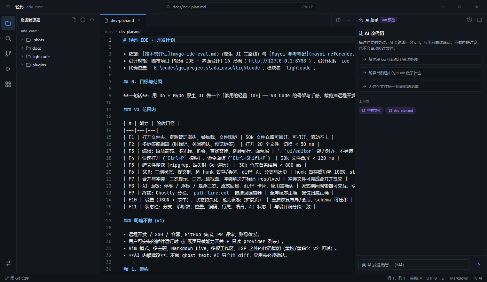

# 轻码 IDE（lightcode）

用 Go + [MyGo](https://mygo.run/zh/docs) 原生 UI 写的轻量 IDE：VS Code 的骨架与手感，裁掉远程开发 / 插件市场 / PR 评审；AI 助手只产出 diff，应用前必须确认。

当前进度：**M0 地基与空壳**（2026-11-17）。计划与验收口径见 [../docs/dev-plan.md](../docs/dev-plan.md)，技术栈评估见 [../docs/mygo-ide-eval.md](../docs/mygo-ide-eval.md)，参考实现笔记见 [../docs/mayoi-reference.md](../docs/mayoi-reference.md)。



## 运行

框架从本地 MyGo 检出构建（`go.mod` 里 `replace github.com/egoist/mygo => ../../mygo`），需要 Go 1.27+、Windows 10 1809+ / macOS 13+ / Linux（GTK 3）。

```powershell
go run ./cmd/lightcode                                  # 打开当前目录
go run ./cmd/lightcode E:\codes\go_projects\ada_case    # 打开文件夹
go run ./cmd/lightcode E:\codes\go_projects\ada_case docs/dev-plan.md   # 并打开一个文件
```

开发时出窗口截图（`CapturePage`，1.2 s 后自动退出）：

```powershell
$env:LIGHTCODE_CAPTURE = "E:\shots\lightcode.png"
go run ./cmd/lightcode <folder> [file]
```

## 现在能做什么

- 打开文件夹：资源管理器懒加载目录、按名称排序、文件按语言着色；打开时建文件索引（30k 约 37–213 ms），`Ctrl+P` 直接查索引。
- 打开文件：多标签、脏点、关闭确认（保存 / 不保存 / 取消）、保存、重新加载；重开已改动的文件会先检测磁盘 mtime。
- 会话恢复：`state.json` 记住打开的文件、活动标签、侧栏显隐与视图、AI 停靠/收起、缩放、分屏；下次启动回到原样。
- 预览标签：树里单击是斜体预览（下一个预览替换它），编辑后自动固定；`Ctrl+P` 打开的是固定标签。
- 外部改动：每 1.5 s 检查打开的文件；干净文件自动重载，有本地修改时出现「重新加载 / 保留我的」横条；工作区变更由 `mygo.WatchFiles`（HintsOnly）刷新树。
- 搜索：侧栏搜索面板，字面量/正则/区分大小写，流式出结果（30k 首条约 7.5 ms），可取消、上限 500；PATH 里有 `ripgrep` 就用它，否则用内置的并行 Go 实现。
- 大纲：Go 用 `go/parser`，Markdown 用标题，其它语言按行首声明；侧栏下半区可拖，点击跳到符号行。
- 文件操作：新建文件/文件夹、重命名、删除（确认、脏文件先拦）、右键菜单，操作后刷新树与索引。
- Git：SCM 面板显示暂存/更改/未跟踪/冲突四组与当前分支（ahead/behind）、提交框、最近 20 条提交；文件点开是并排 diff 页，按块卡片可**逐 hunk 暂存**（`git diff` → `editor.ParsePatch` → 单块应用到索引文本 → `hash-object` + `update-index`，不拼 patch），另可暂存/取消暂存整文件、丢弃（二次确认）。
- 编码：UTF-8、UTF-8 BOM、GBK 自动识别并原样写回；二进制文件拒绝打开。
- 编辑：`ui/editor` 的语法高亮、多光标、折叠、查找替换、跳转到行、Git 改动条（未接 Git 时为空白）。
- 快速打开 `Ctrl+P` 与命令面板 `Ctrl+Shift+P`（模糊匹配、↑↓ 选择、Enter 执行）。
- AI 助手：兼容 OpenAI 的流式客户端（SSE、系统代理、可取消/重试），Key 存系统凭据库（或 `OPENAI_API_KEY`），Base URL/模型在设置弹窗里改；停靠 380 / 悬浮 380×640 / 收起为右侧浮动的 48×172 卡片三态（不占布局、没有空列，悬停可预览上一轮回答）；悬浮面板有独立的标题头（左侧抓手可拖动，右侧三个模式按钮、设置与关闭），模式随会话恢复。回答用 `ui/markdown` 流式渲染，并逐帧揭示（打字机式，即使服务端一次性返回也分段显示），其中 git diff 会被解析成 diff 卡片，点「应用」才写入当前缓冲区（保持未保存），「忽略」可丢弃，也可以展开看差异。上下文是当前文件或选区（上限 8000 字符）。
- 视图：`Ctrl+B` 侧栏；`Ctrl+Shift+E/F/G/X` 切换侧栏视图；`Ctrl+=` / `Ctrl+-` / `Ctrl+0` 缩放；`Ctrl+\` 拆分/关闭分屏（`ui.SplitPercent`，拖动分隔条；两列共享同一 Document 的 undo）；AI 停靠 380 宽，收起后是右侧浮动的 48×172 卡片（不占布局、不留白条），点卡片展开；**悬浮面板与收起卡片都能拖动**（位置写入 `settings.json`），允许浮在代码上方。
- 命令面板可滚动（`ui.Scroll`，↑↓ 选择会自动滚到可见处），`打开文件夹…` 等靠后的命令都能找到。
- 主题：深色 / 浅色两套板（标题栏右上角的☀/☾按钮、设置页「外观」、或 `Ctrl+Shift+T` 切换），编辑器和 diff/AI 卡片一起换色；选择存在 `settings.json` 的 `theme` 字段，窗口菜单与对话框通过主循环跟随系统外观设置。
- 状态栏：分支（读 `.git/HEAD`）、消息、行列、缩进、编码、行尾、语言、AI。
- 终端：底部分栏（可拖高度的 `SplitVerticalPercent`），`Ctrl+`` 开关，`plugins/terminal`（Ghostty libghostty-vt）跑用户 shell，`path:line:col` 链接可用 Ctrl+点击回到编辑器；库缺失时显示原因与「重试」。`go run` 下首次会下载库到缓存，打包应用随包分发。
- 设置：`settings.json` 里的编辑器/终端字号、软换行、能力开关即时生效；设置页显示两个配置文件路径。设置（偏好）与会话（`state.json`）分开。
- 扩展（能力面板）：Git / AI / 终端 / 搜索 / 预览器的 provider 状态与开关；说明这个版本没有可安装扩展，只有构建期内置能力。

分屏会随会话恢复（左/右列的文件、哪列活动、分隔比例都记在 `state.json`）；IME 的中文输入有无头测试，候选窗与真机文件监视仍需人工确认。

## 结构

```
cmd/lightcode          # 装配：窗口、菜单、启动参数
internal/app           # 视图与交互：标题栏、活动栏、侧栏、标签、面包屑、状态栏、命令面板、AI
internal/chrome        # （M1 抽出）无业务的外壳原语
internal/command       # 命令注册表 + VS Code 风格键位解析（菜单/面板/测试共用）
internal/document      # Document（唯一持有 Buffer 与 undo）/ Editor（视图状态）/ Column（标签组）
internal/settings      # state.json：会话恢复、schema 版本、原子写入
internal/search        # 纯 Go 并行 + 流式搜索（字面量/正则/大小写、可取消）
internal/symbols       # 大纲：go/parser、Markdown 标题、行首声明回退
internal/git           # Git CLI：status 解析、diff、逐 hunk 暂存、提交、log
internal/ai            # OpenAI 兼容流式客户端（SSE、代理、取消）
internal/workspace     # 文件夹、懒加载目录、文件索引、模糊匹配
internal/theme         # 设计 token → *ui.Theme、*editor.Theme、尺寸常量
internal/icons         # 内嵌 SVG 图标（不用 emoji，不用字符当图标）
```

### 约定

- 用户动作一律走命令表；面板不私接快捷键；编辑器用 `OnInput` 让应用的键位先吃（`Ctrl+P`/`Ctrl+W` 不会被编辑器吃掉）。
- 只有 `Document` 改文本；视图只读 `Snapshot`；跨线程回写走 `Window.Update`。
- 颜色/圆角/间距只从 `internal/theme` 取；视图里不写字面量。
- Git、AI、终端、搜索在 M2–M5 接入；`internal/git`、`internal/search`、`internal/ai` 尚未创建。

## 测试

```powershell
go build ./... && go vet ./... && go test ./...
```

- 单元：`document`（保存/CRLF/二进制/GBK/BOM/外部改动）、`settings`（默认值/损坏文件/钳制）、`workspace`（排序/懒加载/ignore/模糊/索引）、`command`（键位/注册表）、`search`（大小写/正则/上限/取消/二进制/忽略/rg 解析）、`symbols`（Go/Markdown/回退）、`git`（status 解析/暂存/提交/log）、`ai`（SSE 流式/请求体/HTTP 错误/取消）。
- 交互（`ui.NewTester`）：快速打开、保存脏文件、脏关闭确认、侧栏与 AI 切换、会话恢复、缩放、预览标签、外部改动横条、分屏共享 undo/键位/会话、搜索与跳转、大纲渲染/跳转、文件新建/改名/删除、watcher 刷新树、中文输入、SCM 面板、diff 页与逐块暂存、提交与历史、AI 流式回答/diff 应用/重试/三态与设置、终端错误页与 `path:line:col` 链接、设置页与 settings.json、能力面板开关、明暗主题切换。
- 预算：`internal/app/budget_test.go`（2,000 行文件 20 帧，断言 < 8 ms，实测 0.29 ms）；30k 基准见 `workspace/index_bench_test.go` 与 `search/bench_test.go`（`LIGHTCODE_BENCH=1`）。
- 截图：`internal/app/screenshot_test.go` 输出 `_shots/lightcode-ui-*.png`；`baseline_test.go` 与 `testdata/shots/editor.png` 比像素（1%），`LIGHTCODE_UPDATE_BASELINE=1` 可重生成基线。

会话默认写在用户配置目录（Windows 为 `%AppData%\lightcode\state.json`）；测试与实验可用 `LIGHTCODE_STATE=<path>` 指到别处。

## 里程碑

M0 空壳（已完成）→ M1 会话恢复/外部改动/预览标签/分屏/缩放/编码/IME（已完成）→ M2 工作区（索引、搜索、大纲、文件操作、watcher，已完成）→ M3 Git（status/SCM/diff/逐 hunk 暂存/提交/历史，核心完成；冲突与 remote 待做）→ M4 AI 面板（流式客户端、三态、diff 卡片、确认应用，已完成）→ M5 终端/设置/能力面板（已完成；i18n 未做）→ M6 打磨发布。


